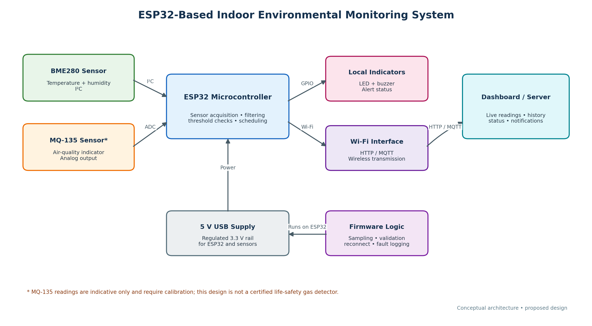

# ESP32-Based Indoor Environmental Monitoring System

A proposed embedded-systems design for monitoring indoor temperature, relative humidity, and an indicative air-quality sensor signal. The system architecture uses an ESP32 microcontroller, local LED/buzzer alerts, and Wi-Fi telemetry to a dashboard/server.

> **Project status:** Requirements and architecture design. Do not claim a physical prototype, calibrated measurements, or completed tests unless you have actually performed them.

## Objectives
- Read temperature and relative humidity from a BME280 sensor over I2C.
- Sample an analog output from an MQ-135 module using a suitable ESP32 ADC input.
- Validate sensor readings and detect sensor/network faults.
- Apply configurable warning thresholds and control local indicators.
- Send telemetry over Wi-Fi using HTTP or MQTT.
- Continue local sensing and alerting during Wi-Fi outages.

## Proposed Hardware
- ESP32 development board
- BME280 temperature/humidity sensor module
- MQ-135 module (indicative signal only; calibration required)
- LED and suitable current-limiting resistor
- Buzzer, with a driver transistor if required by its current
- Appropriate USB supply, wiring, and enclosure

## Architecture



## Requirements and Design Report

[Download the Week 1 Report](Week1_Embedded_System_Requirements_Report.docx)

## Proposed Data Flow
1. Sensors provide measurements to the ESP32.
2. Firmware validates readings and evaluates configured thresholds.
3. LED/buzzer provide local status indication.
4. ESP32 sends readings and device status to a dashboard/server over Wi-Fi when connected.
5. The system continues local monitoring if the network becomes unavailable.

## Example Telemetry Payload
The following values are illustrative only and are not real device measurements.

```json
{
  "device_id": "env-node-01",
  "uptime_s": 125,
  "temperature_c": 26.4,
  "humidity_rh": 58.2,
  "air_quality_adc": 1420,
  "status": "NORMAL",
  "sensor_fault": false
}
```

## Important Safety and Measurement Notes
- MQ-135 is not a certified life-safety gas detector. Do not use it as a replacement for certified smoke or carbon-monoxide alarms.
- Check the exact sensor-module datasheets before wiring.
- Ensure the voltage entering an ESP32 ADC/GPIO stays within the board's permitted range.
- Verify whether the selected MQ-135 module requires a 5 V heater supply and account for its current separately.
- Add calibration and test evidence before describing the system as validated.

## Verification Plan
- Confirm sensor initialization and plausible readings.
- Compare temperature/humidity with a reference instrument.
- Test ADC response using safe input levels.
- Verify threshold alert behavior.
- Disconnect a sensor and check fault handling.
- Disable and restore Wi-Fi; verify local monitoring continues and telemetry resumes.
- Record actual outcomes, hardware versions, and test conditions.

## Repository Setup
This repository contains the Week 1 design deliverables. If implementation is added later, place firmware source in a `firmware/` directory and document board pin mappings, libraries, build steps, and actual test results.

## Author
Prajakta Jadhav
Embedded Systems Engineer Intern
